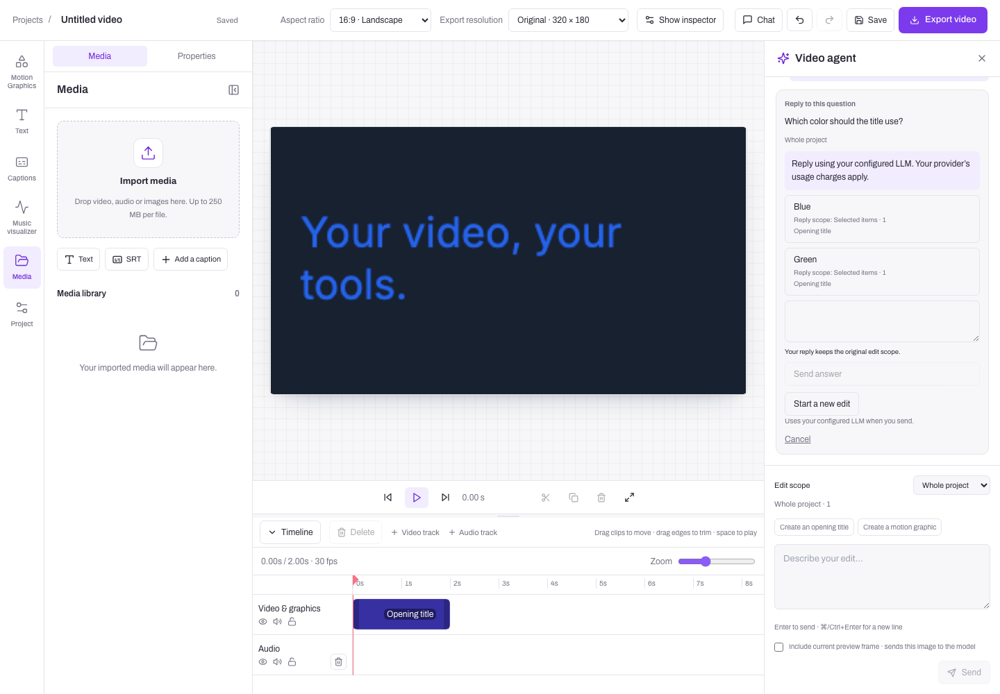

# Dojo Video Harness

A local, English-only open-source video editor with a small TypeScript editing agent. It shares DojoClip’s Next.js App Router, React 18, Tailwind 3, and editor components, with a simpler local host.
Bring your own LLM and transcription providers. Edit the same timeline by hand
or through chat, review the result, and export through [Dojo Video Engine](https://github.com/PansaLegrand/dojo-video-engine) in your browser.

The agent is intentionally understandable: a model adapter, typed function calls,
a tool registry, Markdown skills, bounded execution, and explicit user decisions.
The difficult video-specific rules live in the tested document and command kernel.



_Browser-test screenshot with synthetic model responses._

## Run locally

Requirements: Node **20.19+**, npm, and a desktop browser with WebCodecs support
(Chromium is the tested path). No database, Redis, DojoClip account, or cloud worker
is needed. FFmpeg is required only for the browser acceptance test, not the app.

```sh
git clone https://github.com/PansaLegrand/dojo-video-harness.git
cd dojo-video-harness
npm run launch
```

`launch` installs locked dependencies when missing, creates `.env` without
overwriting an existing file, checks the local environment, and starts the editor.
It opens the browser automatically from an interactive terminal. Otherwise open
**http://127.0.0.1:4310**. Node 22 is recommended and pinned in `.nvmrc`.

Create a project and import media. Manual editing, subtitle import, preview,
motion graphics, and MP4 export work without API keys. In **Provider settings**,
choose OpenAI or Kie and enter your GPT key. Speech recognition has its own provider
settings. Saves apply to new requests immediately; running jobs keep their original
configuration. Saved keys are never returned to the browser.

For later starts, use `npm run dev`. Other useful commands:

```sh
npm run setup        # Install/check without starting; preserves .env
npm run setup -- --install  # Reinstall locked dependencies
npm run doctor       # Check Node, local storage, and port availability
npm run dev -- --no-open    # Start without opening the browser
```

The setup and launcher work in PowerShell as well as macOS/Linux terminals. The
startup CI runs on Windows, macOS, and Linux. If the port is occupied, the launcher
explains how to open the existing editor or change `PORT` in `.env`. It does not
silently switch addresses, because imported browser media belongs to its origin.

Advanced configuration can still use `.env` (copied from `.env.example`). Settings
saved in the app override its provider values and are stored in the private local
data directory as `provider-settings.json`. Keep that directory private and out
of Git when changing `DATA_DIR`.

Shared editor and chat components can be synced from the product when useful. The harness has its own smaller scope; full product parity is not a goal. Local persistence, provider keys, and usage copy live in host adapters. See [syncing the product UI](docs/syncing-product-ui.md).

The agent and caption translation support **GPT models through the Responses API**.
The default model is `gpt-6-sol`. For Kie, use:

```dotenv
LLM_BASE_URL=https://api.kie.ai/codex/v1
LLM_MODEL=gpt-6-sol
LLM_API_KEY=your-kie-key
```

Use the key for the endpoint you configure. The model name is sent unchanged;
there is no automatic model switching or retry. Non-GPT model names are rejected
before a request. Other model families and Chat Completions are outside the
supported scope. Speech recognition has a separate OpenAI-compatible audio
transcription adapter and its own key; Kie chat access does not configure ASR.

ASR must provide genuine word timestamps in `verbose_json`; segment-only output
is rejected rather than converted into invented word timings. This adapter caps
transcription uploads at 25 MiB. Choose a smaller audio source when needed.

Saved keys stay in the local data directory and server process. `.env`, project data, uploaded sources, and
exported videos are ignored by Git. Imported originals first live in browser
IndexedDB. Choosing transcription explicitly copies the source to the local host
and sends it to the configured ASR provider. Choosing chat sends project context;
preview pixels are included only when you check the preview-image option. Provider
usage is charged by your provider. The editor and rendering run locally; configured remote GPT and ASR providers
receive only the context or media needed for the selected operation.

To run the built application:

```sh
npm run build
npm start
```

## What is implemented

- The extracted DojoClip manual editor: multi-track timeline, selection, trim,
  split, text/graphics, captions, styles, transitions, linked groups, source ranges,
  quiet-section analysis, undo/redo, and browser recovery.
- Dojo Video Engine preview, local proxies within admission limits, and browser MP4
  export. The pinned engine packages include the reconciled DojoClip correctness patches.
- Local project persistence with serialized transactions, atomic file replacement,
  revisions, conflict detection, operation receipts, and history.
- A framework-independent agent loop using real function calls. Inspect a project,
  read a skill, search transcript evidence, propose an edit, or ask a question.
- Proposal review with synchronized before/after previews, explicit apply,
  selective undo, structured questions, cancellation, and the product’s quick-edit controls. Tool events remain available through the local API.
- Provider-backed captions and translation, with persisted source-bound receipts.

This is a standalone extraction, not a claim of complete hosted-product parity.
DojoClip billing, accounts, collaboration, hosted asset galleries, and production
worker infrastructure are outside this local application. Image/video generation
jobs are an extension point, not a shipped provider integration. Chat currently
directs users to the caption UI when new transcription is required.

## Read the implementation

Start with [the guided walkthrough](docs/learn-the-harness.md), then follow:

| Location                                               | Responsibility                                                    |
| ------------------------------------------------------ | ----------------------------------------------------------------- |
| `packages/agent/src/loop.ts`                           | Bounded model → tool → observation loop                           |
| `packages/agent/src/tools.ts`                          | Tool descriptions, runtime validation, effects                    |
| `skills/`                                              | Domain instructions loaded by the `read_skill` tool               |
| `packages/adapters/src/`                               | LLM and ASR transports; no document mutation                      |
| `packages/core/src/lib/video-project/`                 | Authoritative document, commands, scope, evidence, history        |
| `packages/ui/src/components/editor/dojo-video-engine/` | Real manual editor and chat/review UI                             |
| `app/`                                                 | English App Router pages and local API route handlers |
| `packages/ui/src/host/`                                | Local user, copy, and provider-request adapters                   |
| `apps/server/src/agent-service.ts`                     | Durable runs, questions, approvals, cancellation                  |
| `apps/server/src/store.ts`                             | Local transactions, receipts, revisions                           |
| `apps/server/src/local-api.ts`                         | Local services behind Next route handlers                         |
| `config/engine-release.json`                          | Pinned engine version, source commit, and registry integrity       |

There is no LangChain, Vercel agent runtime, Pi runtime, or coding-agent subprocess
in the execution path. Pi inspired the small-core approach; a provider or runtime
adapter can be added without giving it authority over document commits.

The harness packages are source workspaces in this repository. They are not
published npm packages. The engine is consumed from the public
`@dojo-video-engine/*` packages at exact version 1.1.1. There is no runtime dependency on a sibling checkout. Development
uses the product’s Next.js 15.5 family, React 18.3, Tailwind 3.4, and shared TypeScript aliases; independently packaged
embeddable SDK distributions are a subsequent release step.

## Verification

```sh
npm run check
npx playwright install chromium
npm run test:browser
```

An optional live GPT acceptance test uses a temporary synthetic timeline and up to
eight paid requests. Set `LLM_BASE_URL`, `LLM_MODEL`, and `LLM_API_KEY` in the shell
(or load your own `.env` before running); the script does not read another checkout:

```sh
npm run test:live:gpt -- --live
```

It verifies inspection/skill use, proposal review, explicit application, and a
question/answer continuation. It is not part of CI and never uses customer media.
See [the GPT core and live Kie verification](docs/gpt-agent-verification-2026-10-31.md).

The browser test needs `ffmpeg` and `ffprobe` on PATH. It starts an isolated real
local server and synthetic LLM/ASR HTTP endpoints, uses actual browser storage and
rendering, and decodes the exported MP4. It never uses `.env` provider credentials.
Artifacts go to ignored `test-results/`. This verifies adapter and workflow behavior,
not the quality or account compatibility of a live paid provider.

The App Router serves the editor at `/en/applications/editor/:projectId` and the shared product home at `/en/applications/video-edit-ai`. Only English UI routes are enabled. The `/en` prefix keeps shared navigation easy to sync. Video text, speech recognition, and caption translation can still use other languages supported by your providers.

See [architecture](docs/architecture.md), [extension guide](docs/extending.md),
[edge cases](docs/edge-cases.md), and [provenance](docs/provenance.md).

## Milestone launch checks

Use `npm run verify:milestone` for the complete local gate. Before a launch, use
`npm run verify:milestone -- --live` on a clean committed candidate with your GPT
provider configured. The paid gate repeats 18 scenarios three times, including an
eight-turn conversation, pending questions/restarts, basic edits, and hard boundaries.
It records complete reports and requires a separate human visual/audio review.
See [the coverage matrix, launch criteria, and commands](docs/agent-milestone-testing.md).

## Engine and application ownership

[dojo-video-engine](https://github.com/PansaLegrand/dojo-video-engine) owns rendering, playback, export, and low-level scene APIs. This repository owns the editor UI and agent harness. The engine no longer ships a competing editor or agent demo.

## License

MIT for the harness and extracted editor code. Dojo Video Engine and third-party assets
retain their own copyright notices. See [THIRD_PARTY.md](THIRD_PARTY.md).
